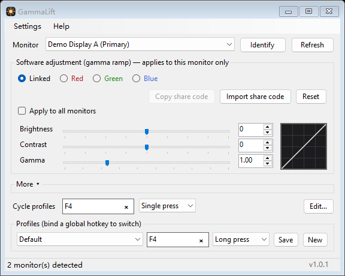
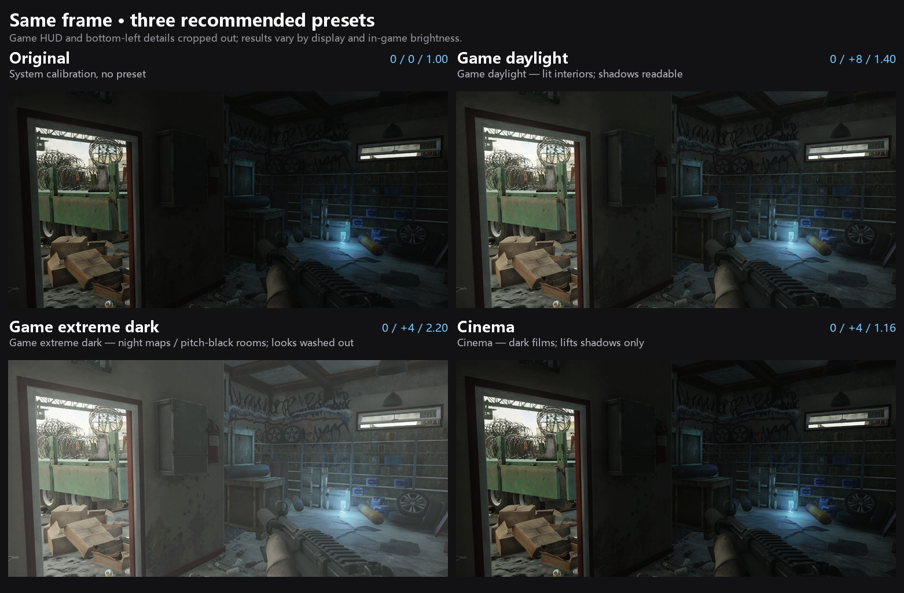
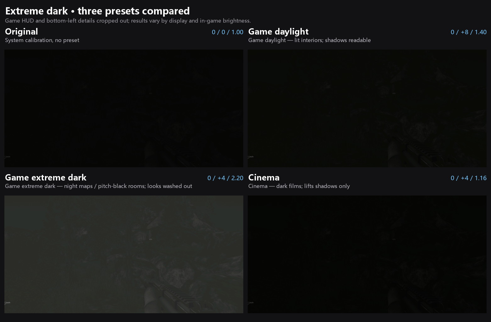

[简体中文](README.md) | **English**

# GammaLift

Per-monitor gamma, brightness, contrast and saturation for Windows.



A modern remake of the classic [Gamma Panel](https://gamma-panel.en.softonic.com/), built on [GammaPanelX](https://github.com/NiseMonox/GammaPanelX). Each monitor can be selected and adjusted independently.

Portable single-file app, about 679 KB — no installer, no .NET SDK or runtime downloads (uses the .NET Framework 4.x that ships with Windows).

The UI ships in 16 languages (Simplified / Traditional Chinese, English, Japanese, Korean, German, French, Spanish, Brazilian Portuguese, Russian, Italian, Turkish, Vietnamese, Indonesian, Dutch, Polish) and follows the system language by default.

## Download

Download `GammaLift.exe` from the [Releases](../../releases) page and double-click to run. Requires Windows 10/11 with the built-in .NET Framework 4.x (usually 4.8); the exe is AnyCPU and single-file.

SmartScreen: the binary is unsigned, so Windows may warn on first run. Choose *More info → Run*, check the SHA256 published with the release, or [build from source](#building) yourself.

## Features

- Per-monitor brightness / contrast / gamma / saturation, each display independent
- Software gamma LUT adjustment
  - Editable multi-profile support
  - Per-display share codes, fully offline, for quickly sharing and applying someone else's preset
  - Global hotkeys support single press, double press and long press, and cycling through the preset list
  - Profile switches show a floating notification
  - Baseline protection: reset restores the system ICC / vcgt calibration exactly
- Hardware DDC/CI adjustment where the monitor supports it
  - Keyed by hardware ID, so settings survive port changes
  - Hardware brightness, contrast and saturation
- Portable single file, 16 UI languages
- The current version number is shown in the bottom-right corner of the status bar

Detailed feature notes, tips and technical background live in [docs/guide.md](docs/guide.md) (Chinese).

GammaLift only changes the display output (GPU gamma LUT and monitor OSD); it never reads or modifies game memory or files.

## Use cases

- Screens used under high background light
- Monitors with insufficient hardware brightness or aged backlights
- Unifying the image across multiple monitors
- Lifting dark game scenes
- Night reading
- Previewing underexposed photos
- Watching low-brightness films
- Switching frequently between multiple presets

## Recommended presets

### Recommended settings

| Preset | Brightness / contrast / gamma | Best for | Share code |
|---|---|---|---|
| Game daylight | 0 / +8 / 1.40 | General dark scenes | `GL2A2RsjADe` |
| Game extreme dark | 0 / +4 / 2.20 | Night maps and pitch-black rooms; emergency use without night vision | `GL2A2Ro3AB5` |
| Cinema | 0 / +4 / 1.16 | Dark films and panels with weak black levels | `GL2A2RodADJ` |

### Example scene 1



### Example scene 2



## Building

```powershell
powershell -ExecutionPolicy Bypass -File build.ps1
# Output: build\GammaLift.exe
```

No .NET SDK required — it compiles with the `csc.exe` bundled with Windows (which is why the source sticks to C# 5 syntax).

## Acknowledgments

GammaLift stands on the shoulders of two giants:

- The classic [Gamma Panel](https://gamma-panel.en.softonic.com/)
- [GammaPanelX](https://github.com/NiseMonox/GammaPanelX) by [NiseMonox](https://github.com/NiseMonox)

GammaLift is a derivative of GammaPanelX. The MIT license and both copyright lines are in [LICENSE](LICENSE).

## Privacy

GammaLift makes no network connections, needs no account, and contains no ads or analytics. Settings live next to `GammaLift.exe` as `GammaLiftSettings.json`; when that folder is not writable, they fall back to a file of the same name in your Documents folder. See the [privacy policy](docs/privacy-policy.en.md) for details.

## License

[MIT](LICENSE)
