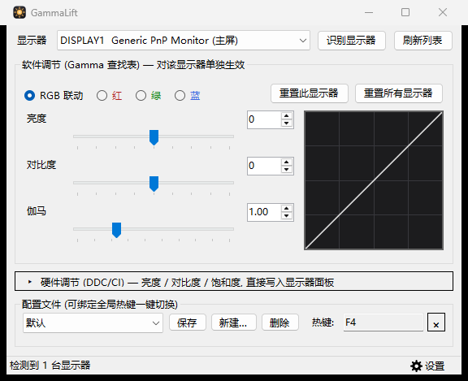
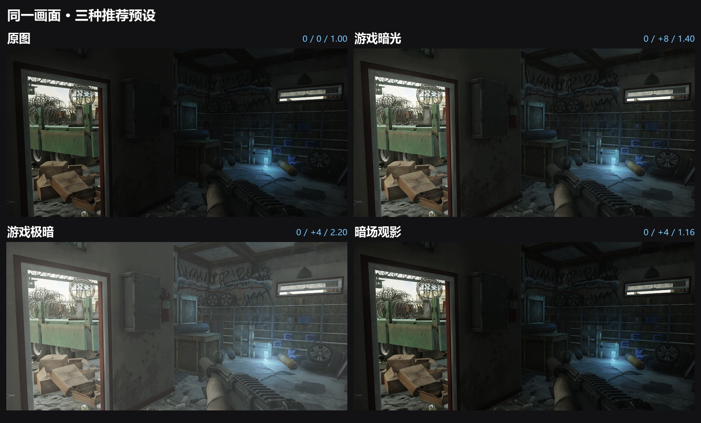
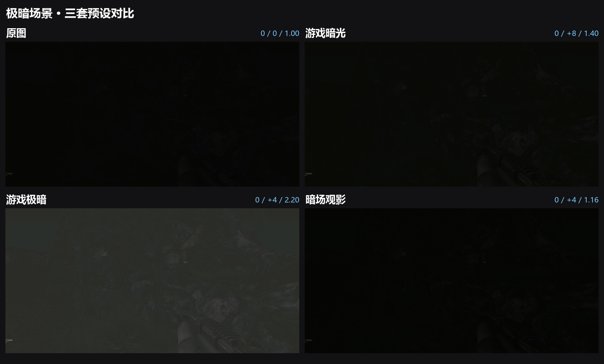

**简体中文** | [English](README.en.md)

# GammaLift

Windows 每显示器 Gamma / 亮度 / 对比度 / 饱和度调节工具。



经典 [Gamma Panel](https://gamma-panel.en.softonic.com/) 的现代复刻版，基于 [GammaPanelX](https://github.com/NiseMonox/GammaPanelX)。每台显示器可独立选择、独立调节。

绿色单文件程序，大小约 679 KB，无需安装，无需 .NET SDK / 运行库（使用 Windows 自带的 .NET Framework 4.x）。

界面内置 16 种语言（简体 / 繁体中文、英语、日语、韩语、德语、法语、西班牙语、巴西葡萄牙语、俄语、意大利语、土耳其语、越南语、印尼语、荷兰语、波兰语），默认跟随系统语言。

## 下载

到 [Releases](../../releases) 页面下载 `GammaLift.exe`，双击即用。需要 Windows 10 / 11 自带的 .NET Framework 4.x（通常为 4.8）；exe 为 AnyCPU 单文件。

SmartScreen 提示：二进制未签名，首次运行 Windows 可能告警。选「更多信息 → 仍要运行」，可核对随 Release 公布的 SHA256，亦可[自行从源码构建](#构建)。

## 功能

- 每台显示器独立调节亮度 / 对比度 / Gamma / 饱和度，互不干扰
- 软件 Gamma LUT 调节
  - 可编辑的多预设功能
  - 单屏参数分享码，全程离线，可以快捷分享套用他人预设
  - 全局热键，支持单击 / 双击 / 长按，也可按列表循环切换预设
  - 切换预设提供悬浮窗通知
  - 基线保护：重置时精确还原系统 ICC / vcgt 校准
- 硬件 DDC/CI 调节，显示器支持时可以在软件内调节硬件参数
  - 绑定硬件ID，更换接口留存设置
  - 支持硬件亮度、对比度、饱和度调整
- 便携单文件、16 种界面语言
- 状态栏右下角显示当前版本号

详细功能说明、使用提示与技术细节见 [docs/guide.md](docs/guide.md)。
GammaLift 只改变显示输出（显卡 Gamma LUT 与显示器 OSD），不读取、不修改任何游戏内存或文件。

## 使用场景

- 高背景光场景下使用屏幕
- 显示器硬件亮度不足或背光老化
- 多显示器统一显示效果
- 游戏暗场景提亮
- 夜间阅读
- 欠曝照片预览
- 观看低亮度电影
- 多套预设频繁切换

## 推荐预设

### 推荐参数

| 预设     | 亮度 / 对比度 / Gamma | 适合场景                       | 分享码          |
| -------- | --------------------- | ------------------------------ | --------------- |
| 游戏暗光 | 0 / +8 / 1.40         | 一般暗场景                     | `GL2A2RsjADe` |
| 游戏极暗 | 0 / +4 / 2.20         | 夜图、全黑房间；无夜视装备应急 | `GL2A2Ro3AB5` |
| 暗场观影 | 0 / +4 / 1.16         | 暗场多的电影、黑位差的面板     | `GL2A2RodADJ` |

### 示例场景1 · 电影暗场观影


### 示例场景2 · 游戏白天室内



### 示例场景3 · 游戏极暗场景



## 构建

```powershell
powershell -ExecutionPolicy Bypass -File build.ps1
# 产物: build\GammaLift.exe
```

无需安装 .NET SDK，使用 Windows 自带的 `csc.exe` 编译（因此源码保持 C# 5 语法）。

## 致谢

GammaLift 站在两个巨人的肩膀上：

- 经典 [Gamma Panel](https://gamma-panel.en.softonic.com/)
- [NiseMonox](https://github.com/NiseMonox) 的 [GammaPanelX](https://github.com/NiseMonox/GammaPanelX)

GammaLift 是基于 GammaPanelX 的衍生项目，MIT 许可证与版权见 [LICENSE](LICENSE)。

## 隐私

GammaLift 不联网、不需要账号、不含广告与分析统计。设置保存在与 `GammaLift.exe` 同目录的 `GammaLiftSettings.json`；该目录不可写时回退至用户「文档」文件夹下的同名文件。完整说明见 [隐私政策](docs/privacy-policy.md)。

## 许可证

[MIT](LICENSE)
